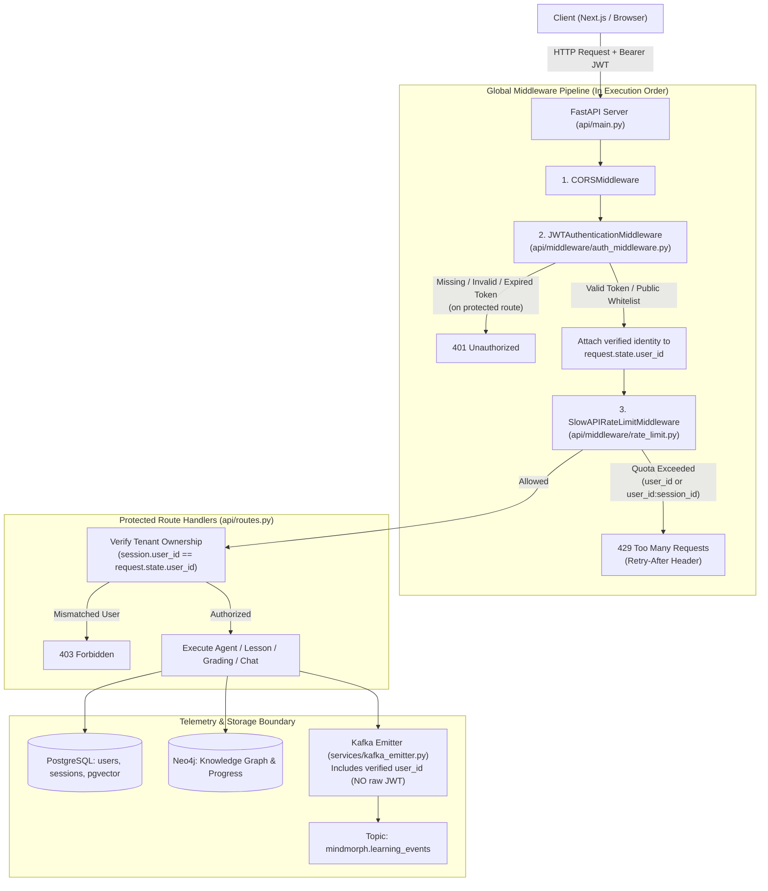

# Master Implementation Plan: JWT Auth, Security Middleware, Rate Limiting & Kafka Provenance

**Document Status:** Ready for Review  
**Target File:** [`docs/JWT_AND_RATE_LIMITING_PLAN.md`](file:///c:/Users/praku/OneDrive/Desktop/MindMorph_Learning_Platform/docs/JWT_AND_RATE_LIMITING_PLAN.md)  
**Execution Condition:** Awaiting User Confirmation ("Yes") before starting implementation.

---

## 1. System Architecture & Request Lifecycle



---

## 2. Component Design & Specifications

### 2.1 Database & User Persistence
* **Model:** `UserRow` in [`persistence/models.py`](file:///c:/Users/praku/OneDrive/Desktop/MindMorph_Learning_Platform/persistence/models.py):
  * `id`: `String` (UUID or unique prefix `usr_...`, primary key)
  * `email`: `String` (unique index, validated via Pydantic `EmailStr`)
  * `hashed_password`: `String` (bcrypt hashed)
  * `full_name`: `String` (optional)
  * `created_at`: `DateTime(timezone=True)`
* **Alembic Migration:** `alembic/versions/0004_create_users_table.py` with unique constraint on `email`.
* **Repository:** `UserRepository` in [`persistence/repository.py`](file:///c:/Users/praku/OneDrive/Desktop/MindMorph_Learning_Platform/persistence/repository.py) providing `create_user()`, `get_by_email()`, and `get_by_id()`.

---

### 2.2 Security Services & JWT Handling
* **Module:** `services/security.py`
* **Password Hashing:** `passlib.context.CryptContext(schemes=["bcrypt"])`.
* **JWT Tokens:** `pyjwt` with `HS256`.
  * Claims payload: `{"sub": user_id, "email": email, "exp": datetime + timedelta(minutes=60), "iat": datetime}`.
  * Configuration: `JWT_SECRET_KEY`, `JWT_ALGORITHM="HS256"`, `ACCESS_TOKEN_EXPIRE_MINUTES=60` in [`config.py`](file:///c:/Users/praku/OneDrive/Desktop/MindMorph_Learning_Platform/config.py).

---

### 2.3 Authentication Endpoints
* **Router:** `api/auth_routes.py` (mounted under `/auth` in `api/main.py`)
  1. `POST /auth/register`: Takes `email`, `password`, `full_name`. Validates password strength ($\ge 8$ chars), hashes password, creates user, and returns access token.
  2. `POST /auth/login`: Validates credentials using standard OAuth2 / JSON body. Returns `{"access_token": token, "token_type": "bearer"}`.
  3. `GET /auth/me`: Returns profile of the current user parsed from token.

---

### 2.4 Global Authentication Middleware
* **Module:** `api/middleware/auth_middleware.py` (`JWTAuthenticationMiddleware`)
* **Behavior:**
  * **Public Path Whitelist:** Automatically skips checks for:
    * `/health`
    * `/docs`, `/redoc`, `/openapi.json`
    * `/auth/login`, `/auth/register`
  * **Protected Paths:**
    * Inspects `Authorization: Bearer <token>`.
    * If missing or malformed $\rightarrow$ Returns immediate `401 Unauthorized` (`{"detail": "Authentication credentials required"}`).
    * If invalid signature or expired $\rightarrow$ Returns `401 Unauthorized` (`{"detail": "Token expired or invalid"}`).
    * If valid $\rightarrow$ Attaches `request.state.user_id = payload["sub"]` and `request.state.email = payload["email"]`, then calls `call_next(request)`.

---

### 2.5 Per-User & Per-Session Rate Limiting
* **Module:** `api/limiter.py` using `slowapi` (`limits` library).
* **Storage Backend:** In-memory by default (`memory://`); supports `REDIS_URL` in production with zero code changes.
* **Granular Limiting Tiers:**
  1. **User Plan Generation:** `@limiter.limit("5/10minute")` on `POST /sessions` (prevents exhausting LLM quota on heavy multi-agent planning).
  2. **Code Grading Runner:** `@limiter.limit("15/minute")` on `POST /sessions/{session_id}/grade` (guards the isolated subprocess execution runner).
  3. **Tutor Chat Streaming:** `@limiter.limit("20/minute")` on `POST /sessions/{session_id}/chat` (protects SSE token streams).
  4. **Per-Session Lesson Opening:** `@limiter.limit("30/minute")` on `POST /sessions/{session_id}/lessons/{node_id}`.
* **Key Derivation Strategy:**
  * For session endpoints: Key is resolved dynamically as `f"{request.state.user_id}:{session_id}"`.
  * For global endpoints: Key is `request.state.user_id` (or client IP fallback for public registration/login).
* **Exceeded Behavior:** Returns standard `429 Too Many Requests` with a descriptive JSON body and `Retry-After` header.

---

### 2.6 Multi-Tenant Session Gating
* **In [`api/routes.py`](file:///c:/Users/praku/OneDrive/Desktop/MindMorph_Learning_Platform/api/routes.py):**
  * Replace caller-supplied URL path parameter `{user_id}` with `request.state.user_id`.
  * In `_load_or_404(repo, user_id, session_id)`:
    * Load session. If `session["user_id"] != request.state.user_id`, raise `HTTPException(status_code=403, detail="Forbidden: You do not own this learning session")`.

---

### 2.7 Kafka Event Provenance (Token Verification Decision)
* **Decision:**
  * **No Raw JWT in Kafka:** Storing short-lived JWTs in Kafka logs causes token leakage and breaks asynchronous historical event processing after the token expires.
  * **Verified Ingress Provenance:** Events emitted by [`services/kafka_emitter.py`](file:///c:/Users/praku/OneDrive/Desktop/MindMorph_Learning_Platform/services/kafka_emitter.py) and [`services/events.py`](file:///c:/Users/praku/OneDrive/Desktop/MindMorph_Learning_Platform/services/events.py) now include the verified `user_id` extracted by the auth middleware:
    ```json
    {
      "ts": "2026-10-28T09:30:00.000000+00:00",
      "stage": "exercise_graded",
      "user_id": "usr_9b1deb4d3b7d",
      "session_id": "user:python-concurrency",
      "node_id": "asyncio-event-loops",
      "score": 85.0,
      "passed": true
    }
    ```

---

## 3. Step-by-Step Implementation Sequence

| Step | Phase | Key Files Involved | Description |
|:---:|---|---|---|
| **1** | Dependencies & Config | `requirements.txt`, `config.py` | Add `pyjwt`, `passlib[bcrypt]`, `slowapi`. Define JWT secret & rate limit configuration. |
| **2** | Database & Migration | `persistence/models.py`, `alembic/versions/` | Create `UserRow` table and generate Alembic migration `0004_create_users_table.py`. |
| **3** | Security Utilities | `services/security.py` | Implement password hashing, verify password, create JWT access token, and decode JWT access token. |
| **4** | Auth Endpoints | `api/auth_routes.py`, `api/schemas.py` | Implement `POST /auth/register`, `POST /auth/login`, and `GET /auth/me`. |
| **5** | Auth Middleware | `api/middleware/auth_middleware.py` | Create `JWTAuthenticationMiddleware` checking token validity and injecting `request.state.user_id`. |
| **6** | Rate Limiting Engine | `api/limiter.py` | Initialize SlowAPI limiter with composite per-user and per-session key resolvers. |
| **7** | App Assembly | `api/main.py` | Add middlewares in order: CORS $\rightarrow$ Auth Middleware $\rightarrow$ Rate Limit Middleware. Mount `/auth` routes. |
| **8** | Route Multi-Tenancy | `api/routes.py` | Eliminate unauthenticated `user_id` route inputs. Enforce tenant isolation (`403 Forbidden`). Apply rate limit decorators. |
| **9** | Kafka Provenance | `services/events.py`, `services/kafka_emitter.py` | Ensure all emitted events include the verified `user_id`. |
| **10** | Automated Test Suite | `tests/test_auth_security.py`, `tests/test_rate_limiting.py` | Write comprehensive pytest suites: registration, login, token expiry, middleware rejection, tenant 403, and 429 rate limiting. |

---

## 4. Verification & Testing Criteria

1. **Auth Test:**
   - Register new user $\rightarrow$ returns 201 + valid JWT.
   - Login with invalid password $\rightarrow$ returns 401.
   - Access protected endpoint without token $\rightarrow$ returns 401.
   - Access protected endpoint with valid token $\rightarrow$ returns 200 and matches `request.state.user_id`.
2. **Multi-Tenancy Test:**
   - User B attempts to access or grade User A's `session_id` $\rightarrow$ returns 403 Forbidden.
3. **Rate Limiting Test:**
   - Send 6 rapid requests to `POST /sessions` $\rightarrow$ first 5 succeed, 6th returns 429 Too Many Requests with `Retry-After`.
4. **Kafka Verification:**
   - Consume `mindmorph.learning_events` and verify the payload contains the verified `user_id` and zero raw JWT tokens.
