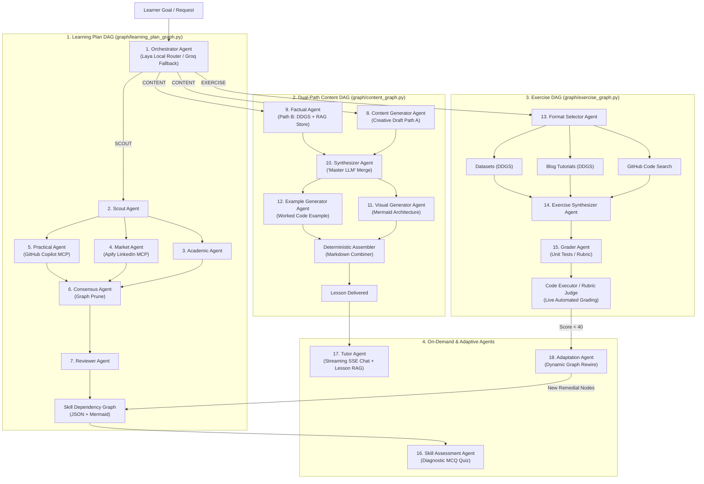

# MindMorph — Complete Multi-Agent System Architecture & Reference (`agents.md`)

> **Document Status:** Complete & Verified Reference  
> **Source Mapping:** [`docs/ARCHITECTURE.md:L234`](file:///c:/Users/praku/OneDrive/Desktop/MindMorph_Learning_Platform/docs/ARCHITECTURE.md#L234), [`docs/IMPLEMENTATION_STATUS.md`](file:///c:/Users/praku/OneDrive/Desktop/MindMorph_Learning_Platform/docs/IMPLEMENTATION_STATUS.md), [`README.md`](file:///c:/Users/praku/OneDrive/Desktop/MindMorph_Learning_Platform/README.md)  
> **Core Framework:** **LangGraph** (State Graphs / DAGs) + **Laya** (Local Decision Routing) + **FastAPI** + **Next.js**

---

## 1. System-Wide Agent Inventory & Taxonomy

The MindMorph Learning Platform is built on a **single-responsibility multi-agent architecture**. Rather than delegating complex educational workflows to a single monolithic prompt, the system breaks educational delivery into **16 specialized agent modules** (encapsulating **18 distinct agent classes**), orchestrated into **4 Directed Acyclic Graph (DAG) state machines**.



### High-Level Agent Counts

| Category | Count | Implementations / Roles |
|---|:---:|---|
| **Learning Plan DAG Agents** | **7** | Orchestrator, Scout, Academic, Market, Practical, Consensus, Reviewer |
| **Content Generation DAG Agents** | **5** | Content Generator, Factual, Synthesizer, Visual Generator, Example Generator *(plus 1 deterministic Assembler)* |
| **Exercise Generation DAG Agents** | **3** | Format Selector, Exercise Synthesizer, Grader *(plus code executor runner)* |
| **On-Demand / Interactive Agents** | **3** | Skill Assessment, Adaptation, Tutor (AI Teaching Assistant) |
| **Total Implemented Agent Classes** | **18** | Across 16 directory packages in [`agents/`](file:///c:/Users/praku/OneDrive/Desktop/MindMorph_Learning_Platform/agents) |
| **Target Architecture Planned Agents** | **2** | Screen Vision Agent, Browser Automation Agent (Roadmap P3 #11) |

---

## 2. Learning Plan Generation DAG

Orchestrated via [`graph/learning_plan_graph.py`](file:///c:/Users/praku/OneDrive/Desktop/MindMorph_Learning_Platform/graph/learning_plan_graph.py). Initiated when a student specifies a learning goal (e.g., *"I want to master Python for Data Engineering"*).

---

### 1. Orchestrator Agent
* **File Location:** [`agents/orchestrator/orchestrator_agent.py`](file:///c:/Users/praku/OneDrive/Desktop/MindMorph_Learning_Platform/agents/orchestrator/orchestrator_agent.py)
* **What the Agent is Working For:**
  * Acts as the primary ingress router of the entire platform.
  * Inspects incoming user queries and classifies intent into one of three routes:
    1. `SCOUT` — Build a brand-new, end-to-end multi-disciplinary skill roadmap.
    2. `CONTENT` — Generate an in-depth lesson for an individual topic or skill node.
    3. `EXERCISE` — Build a hands-on coding challenge or case study quiz.
* **Why It Exists:**
  * **Intent Disambiguation:** A learner might ask *"Teach me Python lists"* (wants content), *"How do I become an ML Engineer?"* (wants a structured path), or *"Give me a quiz on recursion"* (wants an exercise). A dedicated router prevents accidental pipeline misfires and protects heavy downstream generation pipelines.
  * **Zero-Latency Routing with Laya:** Routing via large generative chat models takes 1.5–2.5 seconds, wastes API tokens, and risks JSON syntax crashes. The Orchestrator integrates the in-process **Laya local decision model** to make mathematical routing decisions in $< 40$ ms at $\$0.00$ cost, falling back to Groq/Ollama only if Laya is unavailable.
* **Tools, APIs & Data Sources:**
  * **Primary Engine:** **Laya Local Decision Model** (`convaiinnovations/laya`, ~421M parameter ModernBERT, Apache 2.0) via [`services/routing/laya_router.py`](file:///c:/Users/praku/OneDrive/Desktop/MindMorph_Learning_Platform/services/routing/laya_router.py).
  * **Fallback Engine:** ProviderChain (`ChatGroq` pool `openai/gpt-oss-120b` or local Ollama `qwen2.5:7b`) via [`config.py`](file:///c:/Users/praku/OneDrive/Desktop/MindMorph_Learning_Platform/config.py).
  * **Prompt Registry:** LangSmith prompt tracking via `setup_agent_prompt`.
* **Inputs & Outputs:**
  * *Input:* `user_query: str`
  * *Output:* `Orchestrator_Output_Schema(Assigned_Agent="SCOUT"|"CONTENT"|"EXERCISE", Reasoning=str)`
* **Resilience & Degradation:** Catches all Laya runtime exceptions, memory limits, or missing package errors, logging a warning and falling back to the Groq/Ollama LLM router without failing user requests.

---

### 2. Scout Agent
* **File Location:** [`agents/scout/scout_agent.py`](file:///c:/Users/praku/OneDrive/Desktop/MindMorph_Learning_Platform/agents/scout/scout_agent.py)
* **What the Agent is Working For:**
  * Takes the learner's high-level goal and decomposes it into 3 targeted, specialized search/research questions:
    1. An `ACADEMIC` prompt targeting university curricula and theoretical textbooks.
    2. A `MARKET` prompt targeting job postings and employer requirements.
    3. A `PRACTICAL` prompt targeting open-source repositories and hands-on projects.
* **Why It Exists:**
  * **Domain Specialization:** Asking an academic agent a generic user prompt produces vague syllabi; asking a job scraper a conversational question like *"I want to learn web dev"* yields zero search hits on job boards. The Scout Agent acts as an expert prompt engineer and researcher, formulating precise query parameters for each downstream specialist.
* **Tools, APIs & Data Sources:**
  * **LLM Engine:** `config.get_chat_model("complex")` (Groq `openai/gpt-oss-120b` or Ollama `qwen2.5:14b`).
  * **Prompt Registry:** Configured with `SCOUT_SYSTEM_PROMPT_FOR_QUERIES`.
* **Inputs & Outputs:**
  * *Input:* `user_query: str`
  * *Output:* `ScoutOutputSchema(sub_agent_queries={"ACADEMIC": str, "MARKET": str, "PRACTICAL": str})`
* **Resilience & Degradation:** If decomposition fails, the graph falls back to passing the raw user query directly to the specialists.

---

### 3. Academic Agent
* **File Location:** [`agents/academic/academic_agent.py`](file:///c:/Users/praku/OneDrive/Desktop/MindMorph_Learning_Platform/agents/academic/academic_agent.py)
* **What the Agent is Working For:**
  * Researches the theoretical foundation of the topic across accredited world-class universities.
  * Dynamically searches and scrapes domain-specific curriculum "slivers", course syllabi, and lecture outlines from institutions like Harvard, Oxford, MIT, Stanford, Cambridge, UC Berkeley, and Carnegie Mellon University (CMU).
  * Formulates a structured curriculum rooted in canonical academic programs, ACM/IEEE computing curricula, and primary literature.
  * Identifies mandatory foundational prerequisites (e.g., discrete mathematics, systems theory, algorithms) that informal crash courses often skip, contributing verified academic milestones to the final skill graph.
* **Why It Exists:**
  * **Preventing Knowledge Gaps:** Bootcamps and tutorials often jump straight to frameworks (e.g., teaching React without JavaScript fundamentals, or TensorFlow without linear algebra). The Academic Agent ensures foundational durability, guaranteeing the learner understands *why* systems work, not just *how* to copy-paste code.
  * **Grounding in World-Class Curricula:** By pulling real course outlines from Harvard, Oxford, MIT, and Stanford, the generated skill graph reflects the rigorous standards of premier computer science and engineering institutions.
* **Tools, APIs & Data Sources:**
  * **University Syllabus & Slivers Scraper:** [`tools/academic_scraper_tool.py`](file:///c:/Users/praku/OneDrive/Desktop/MindMorph_Learning_Platform/tools/academic_scraper_tool.py) (`UniversityScraperService`).
    * Targeted academic searches scoped to premier university domains: `harvard.edu`, `ox.ac.uk`, `mit.edu`, `stanford.edu`, `cam.ac.uk`, `berkeley.edu`, and `cs.cmu.edu`.
    * Scrapes course guides and syllabus slivers over HTTP (`httpx`), cleans HTML markup, removes navigation boilerplate, and extracts clean module outlines.
    * Injects verified university course excerpts directly into the LLM prompt block (`VERIFIED UNIVERSITY COURSE SYLLABI & SLIVERS`).
  * **LLM Engine:** `config.llm` executing [`prompts/academic_prompt.py`](file:///c:/Users/praku/OneDrive/Desktop/MindMorph_Learning_Platform/prompts/academic_prompt.py).
  * **Skill Graph Contribution:** Contributes foundational prerequisite trees, core theory nodes, and academic rigor to the downstream Consensus and Skill Graph Agents.
* **Inputs & Outputs:**
  * *Input:* Scout's `ACADEMIC` query string.
  * *Output:* Structured Markdown syllabus detailing course modules, theoretical milestones, verified university course references, and core prerequisites.
* **Resilience & Degradation:** If live university scraping fails or is blocked by network filters, the scraper degrades gracefully, and the LLM constructs the academic roadmap using canonical pre-trained curricula benchmarks.

---

### 4. Market & Trends Agent (`MarketAnalysisAgent`)
* **File Location:** [`agents/market/market_agent.py`](file:///c:/Users/praku/OneDrive/Desktop/MindMorph_Learning_Platform/agents/market/market_agent.py)
* **What the Agent is Working For:**
  * Grounds the learning path in real-time industry employment demand across global job boards.
  * Scrapes and aggregates open, login-free job postings and job descriptions (JDs) across **Indeed**, **Naukri**, **Glassdoor**, **LinkedIn**, and open applicant tracking boards (Greenhouse, Lever).
  * Extracts required tech stacks, tools, and libraries, calculating exact skill frequencies across distinct employers.
  * Identifies seniority distributions, role specializations, and emerging framework shifts to shape the skill graph.
* **Why It Exists:**
  * **Employability Alignment:** Academic curricula are often 3–5 years behind the industry (e.g., teaching Hadoop instead of Spark/Flink, or outdated libraries). The Market Agent injects live market signals so students do not spend months mastering obsolete tooling.
  * **Beyond Single-Platform Bias (Not Just LinkedIn):** Job markets vary across regions and industries. Relying on LinkedIn alone misses high-volume engineering jobs on Indeed, tech portals like Naukri, and compensation/role breakdowns on Glassdoor. An open-source, multi-platform scraper captures a holistic cross-section of global hiring demand.
  * **Eliminating LLM Counting Hallucinations:** LLMs frequently invent fake frequency stats when summarizing text. This agent collapses duplicate postings and counts skill frequency strictly in Python (`Counter`) over distinct employers before the LLM writes its summary.
* **Tools, APIs & Data Sources:**
  * **Multi-Platform Open Job Scraper:** [`tools/multi_platform_job_scraper.py`](file:///c:/Users/praku/OneDrive/Desktop/MindMorph_Learning_Platform/tools/multi_platform_job_scraper.py) (`MultiPlatformJobScraper`).
    * Queries and parses public job descriptions across **Indeed**, **Naukri**, **Glassdoor**, **LinkedIn**, and open web applicant boards (Greenhouse, Lever) without requiring user login or paid subscriptions.
    * Standardizes job postings into structured records (`title`, `company`, `location`, `platform`, `description`, `skills`).
    * Extracts canonical skills (languages, databases, cloud, DevOps, AI/ML frameworks) via regex tokenization and computes employer-deduplicated skill frequencies.
    * Attaches platform provenance (e.g., `[Source: Indeed]`, `[Source: Naukri]`, `[Source: Glassdoor]`) to employer blocks.
  * **Optional Apify LinkedIn MCP Server:** Via [`tools/job_scrapper_tool.py`](file:///c:/Users/praku/OneDrive/Desktop/MindMorph_Learning_Platform/tools/job_scrapper_tool.py) (`APIFY_API_TOKEN`) for enriched LinkedIn search when API credits are present.
  * **Job Title Distillation:** LLM `extract_job_title` converts verbose Scout queries into 2–4 word search titles (e.g., "Senior Machine Learning Engineer").
  * **Timeout Guard:** Wrapped in [`tools/mcp_timeout.py`](file:///c:/Users/praku/OneDrive/Desktop/MindMorph_Learning_Platform/tools/mcp_timeout.py) (20s asyncio timeout).
  * **LLM Engine:** `config.llm` summarizes the multi-source employer blocks into structured market insights.
* **Inputs & Outputs:**
  * *Input:* Scout's `MARKET` query string + location (default `"United States"`).
  * *Output:* Dict `{"sampled": int, "summary": str}` with ranked skills per employer, cross-platform provenance, and experience requirements.
* **Resilience & Degradation:** If Apify is unavailable, the agent seamlessly operates via `MultiPlatformJobScraper` with zero API keys. If network scraping fails entirely, it safely falls back to LLM synthetic market insights, ensuring the learning plan graph never breaks.

---

### 5. Practical Agent
* **File Location:** [`agents/practical/practical_agent.py`](file:///c:/Users/praku/OneDrive/Desktop/MindMorph_Learning_Platform/agents/practical/practical_agent.py)
* **What the Agent is Working For:**
  * Grounds the curriculum in production open-source codebases and hands-on developer workflows.
  * Searches GitHub for top-starred repositories, production boilerplates, and reference implementations matching the learning goal.
* **Why It Exists:**
  * **Real-World Application:** Theory without code is passive; job requirements without hands-on implementation are abstract. The Practical Agent links every concept to genuine open-source projects so learners can inspect production architecture, unit test suites, and project directory layouts.
* **Tools, APIs & Data Sources:**
  * **Tool / API Transport:** **GitHub Copilot MCP Server** via [`tools/github_mcp_client.py`](file:///c:/Users/praku/OneDrive/Desktop/MindMorph_Learning_Platform/tools/github_mcp_client.py) (`https://api.githubcopilot.com/mcp/`) using `GITHUB_PERSONAL_TOKEN`.
  * **Query Normalization:** `to_search_query` in `github_mcp_client.py` strips generic stopwords ("how to", "best ways", "github") and bounds queries to $\le 6$ keywords and $\le 200$ characters, avoiding GitHub's 256-character search API crash.
  * **Timeout Guard:** Wrapped in [`tools/mcp_timeout.py`](file:///c:/Users/praku/OneDrive/Desktop/MindMorph_Learning_Platform/tools/mcp_timeout.py).
  * **LLM Engine:** `config.llm` executes [`prompts/practical_prompt.py`](file:///c:/Users/praku/OneDrive/Desktop/MindMorph_Learning_Platform/prompts/practical_prompt.py).
* **Inputs & Outputs:**
  * *Input:* Scout's `PRACTICAL` query + GitHub search repo list (names, URLs, stars, descriptions).
  * *Output:* Structured Markdown practical guide citing real GitHub codebases.
* **Resilience & Degradation:** If `GITHUB_PERSONAL_TOKEN` is unset or GitHub MCP times out, it logs a WARNING and falls back to generating practical advice from pre-trained knowledge.

---

### 6. Consensus Agent
* **File Location:** [`agents/consensus/consensus_agent.py`](file:///c:/Users/praku/OneDrive/Desktop/MindMorph_Learning_Platform/agents/consensus/consensus_agent.py)
* **What the Agent is Working For:**
  * Serves as the fan-in convergence point for Academic, Market, and Practical reports.
  * Reconciles tensions between academic theory, live market tools, and open-source practices.
  * Compiles findings into a structured **Skill Dependency Graph** (nodes and directed prerequisite edges).
* **Why It Exists:**
  * **Multi-Perspective Reconciliation:** The Academic Agent wants to teach 4 semesters of math; the Market Agent wants 10 popular frameworks; the Practical Agent wants full-stack projects. The Consensus Agent acts as the curriculum architect, ordering skills into an achievable dependency hierarchy.
  * **Graph Invariant Enforcement:** LLMs occasionally hallucinate edge connections to non-existent node IDs. The Consensus Agent passes its output through `prune_dangling_edges` ([`graph/skill_graph_adapt.py`](file:///c:/Users/praku/OneDrive/Desktop/MindMorph_Learning_Platform/graph/skill_graph_adapt.py)), stripping invalid edges before they reach the renderer or database.
* **Tools, APIs & Data Sources:**
  * **LLM Engine:** `config.get_chat_model("complex")` with structured output schema `SkillGraph` ([`agents/consensus/skill_graph_schema.py`](file:///c:/Users/praku/OneDrive/Desktop/MindMorph_Learning_Platform/agents/consensus/skill_graph_schema.py)).
  * **Renderer Tool:** [`graph/skill_graph_render.py`](file:///c:/Users/praku/OneDrive/Desktop/MindMorph_Learning_Platform/graph/skill_graph_render.py) transforms the JSON graph into deterministic Mermaid syntax.
* **Inputs & Outputs:**
  * *Input:* `user_query`, `academic_output`, `market_text`, `practical_output`.
  * *Output:* Validated `SkillGraph` JSON dictionary with node metadata (`id`, `label`, `description`, `category`) and prerequisite edge pairs (`source`, `target`).

---

### 7. Reviewer Agent
* **File Location:** [`agents/reviewer/reviewer_agent.py`](file:///c:/Users/praku/OneDrive/Desktop/MindMorph_Learning_Platform/agents/reviewer/reviewer_agent.py)
* **What the Agent is Working For:**
  * Acts as an autonomous quality assurance auditor for the generated Skill Dependency Graph.
  * Validates pedagogical soundness, checks for circular dependencies, flags missing prerequisites, and verifies that the roadmap directly satisfies the user's initial objective.
* **Why It Exists:**
  * **Quality Gating & Observability:** Generative pipelines can occasionally output disconnected graphs or overly broad scopes. The Reviewer Agent audits the graph before the user begins studying, logging explicit warnings in telemetry if standards are violated.
* **Tools, APIs & Data Sources:**
  * **LLM Engine:** `config.get_chat_model("complex")` with structured output schema `ReviewResult` ([`agents/reviewer/review_schema.py`](file:///c:/Users/praku/OneDrive/Desktop/MindMorph_Learning_Platform/agents/reviewer/review_schema.py)).
* **Inputs & Outputs:**
  * *Input:* `user_query`, serialized `skill_graph_json`.
  * *Output:* `ReviewResult(passed=bool, notes=str)`.
* **Resilience & Degradation:** If review evaluation fails or rejects the graph, the platform logs the audit notes loudly at `WARNING` while serving the repaired graph to prevent blocking the user experience.

---

## 3. Dual-Path Content Generation DAG

Orchestrated via [`graph/content_graph.py`](file:///c:/Users/praku/OneDrive/Desktop/MindMorph_Learning_Platform/graph/content_graph.py). Triggers when a learner clicks an unlocked skill node in the graph.

---

### 8. Content Generator Agent (Creative Draft Path A)
* **File Location:** [`agents/content_generator/content_agent.py`](file:///c:/Users/praku/OneDrive/Desktop/MindMorph_Learning_Platform/agents/content_generator/content_agent.py)
* **What the Agent is Working For:**
  * Writes the engaging pedagogical draft for a lesson (Path A of the dual-path generator).
  * Formats lesson depth according to the user's schedule:
    * **Format A (Boost):** 5-minute punchy conceptual overview.
    * **Format B (Builder):** 20-minute balanced explainer with mechanics and diagrams.
    * **Format C (Sprint):** 2-hour exhaustive deep dive with edge cases and architectural trade-offs.
  * Injects `remediation` gap guidance if the learner previously failed an exercise on this node.
* **Why It Exists:**
  * **Adaptive Learning Delivery:** One-size-fits-all textbooks fail learners with different time budgets. A dedicated creative agent can adapt metaphors, tone, and depth to 5-minute or 2-hour formats.
  * **Path-Language Grounding:** Uses `path_context` to guarantee that generic concepts are taught in the language of the overall path (e.g., teaching "Data Structures" in JavaScript for a MERN path, but Python for an AI path).
* **Tools, APIs & Data Sources:**
  * **LLM Engine:** `config.llm` via [`prompts/content_generator_prompt.py`](file:///c:/Users/praku/OneDrive/Desktop/MindMorph_Learning_Platform/prompts/content_generator_prompt.py).
* **Inputs & Outputs:**
  * *Input:* `user_query`, `format_type` ("A"|"B"|"C"), optional `remediation`, `path_context`.
  * *Output:* Markdown lesson draft (`creative_draft`).

---

### 9. Factual Agent (Live Grounding & RAG Path B)
* **File Location:** [`agents/factual/factual_agent.py`](file:///c:/Users/praku/OneDrive/Desktop/MindMorph_Learning_Platform/agents/factual/factual_agent.py)
* **What the Agent is Working For:**
  * Executes Path B of the dual-path content engine.
  * Queries the live web and the learner's uploaded documents for factual citations, current library versions, official release notes, and documentation snippets.
* **Why It Exists:**
  * **Hallucination Suppression:** LLM knowledge cutoffs cause models to cite deprecated APIs (e.g., LangChain v0.1 syntax or outdated React hooks). Live search guarantees modern syntax and provides clickable source citations.
  * **Learner Document Ingestion:** Blends live web searches with semantic vector retrieval over personal notes and PDFs uploaded by the student.
* **Tools, APIs & Data Sources:**
  * **Live Search API:** **DuckDuckGo Search (`ddgs` / duckduckgo-search SDK)**.
  * **RAG Vector Store:** Resolves via [`graph/content_graph.py:L61`](file:///c:/Users/praku/OneDrive/Desktop/MindMorph_Learning_Platform/graph/content_graph.py#L61) `_resolve_retriever`:
    * FastEmbed (`BAAI/bge-small-en-v1.5`, ONNX, local, zero-cost).
    * Storage: PostgreSQL `pgvector` (`rag_chunks` table) or local `InMemoryVectorStore`.
* **Inputs & Outputs:**
  * *Input:* `query: str`, optional `user_id` for per-user document isolation.
  * *Output:* Bulleted text block with titles, snippets, and `Source: <url>` markdown links.
* **Resilience & Degradation:** Degrades gracefully to `None` if search fails or network is disconnected, allowing the Synthesizer to fall back to the creative draft.

---

### 10. Synthesizer Agent ("Master LLM")
* **File Location:** [`agents/synthesizer/synthesizer_agent.py`](file:///c:/Users/praku/OneDrive/Desktop/MindMorph_Learning_Platform/agents/synthesizer/synthesizer_agent.py)
* **What the Agent is Working For:**
  * Merges Path A (Creative Draft) and Path B (Factual Web + RAG Findings).
  * Weaves verifiable citations and current documentation links into the engaging narrative draft, producing the final lesson body.
* **Why It Exists:**
  * **Dual-Path Synthesis:** Raw search results are dry and unengaging; creative LLM drafts are engaging but prone to factual inaccuracies. The Synthesizer achieves the best of both worlds: lively instructional voice grounded in real-world facts.
* **Tools, APIs & Data Sources:**
  * **LLM Engine:** `config.get_chat_model("default")` via [`prompts/synthesizer_prompt.py`](file:///c:/Users/praku/OneDrive/Desktop/MindMorph_Learning_Platform/prompts/synthesizer_prompt.py).
* **Inputs & Outputs:**
  * *Input:* `user_query`, `creative_draft`, `factual_findings`.
  * *Output:* Unified, publication-ready Markdown lesson text (`final_content`).
* **Resilience & Degradation:** If `factual_findings` is empty or `None`, it automatically returns the creative draft verbatim without making an unnecessary second LLM call.

---

### 11. Visual Generator Agent (Content Tail)
* **File Location:** [`agents/visual_generator/visual_generator_agent.py`](file:///c:/Users/praku/OneDrive/Desktop/MindMorph_Learning_Platform/agents/visual_generator/visual_generator_agent.py)
* **What the Agent is Working For:**
  * Generates a single visual concept diagram or flowchart in Mermaid markdown syntax to accompany the lesson.
* **Why It Exists:**
  * **Multimodal Visual Comprehension:** Many students are visual learners who struggle with walls of text. Diagrams clarify state machines, data lifecycles, and architecture patterns.
  * **Strict Syntax Validation:** LLMs often emit malformed diagram syntax. This agent validates output against regex guards (`flowchart`, `sequenceDiagram`, `classDiagram`) and requires fenced ```` ```mermaid ```` blocks, rejecting invalid text so the frontend never renders a broken box.
* **Tools, APIs & Data Sources:**
  * **LLM Engine:** `config.llm` via [`prompts/visual_generator_prompt.py`](file:///c:/Users/praku/OneDrive/Desktop/MindMorph_Learning_Platform/prompts/visual_generator_prompt.py).
  * **Validation Regexp:** `_MERMAID_FENCE` and `_MERMAID_HEADER`.
* **Inputs & Outputs:**
  * *Input:* Synthesized lesson Markdown, `user_query`.
  * *Output:* Fenced Mermaid diagram string or `None`.

---

### 12. Example Generator Agent (Content Tail)
* **File Location:** [`agents/example_generator/example_generator_agent.py`](file:///c:/Users/praku/OneDrive/Desktop/MindMorph_Learning_Platform/agents/example_generator/example_generator_agent.py)
* **What the Agent is Working For:**
  * Generates a concrete, production-style, runnable code example illustrating the lesson's central concept.
* **Why It Exists:**
  * **Hands-on Demonstration:** Lessons must bridge theory and execution. A dedicated worked example gives the student a reference solution before they attempt the subsequent exercise.
  * **Brace Escaping:** Lesson code containing JSX braces `{count}` or Python dictionary literals breaks standard LangChain prompt templates. This agent safely escapes literal braces via `_escape_braces`.
* **Tools, APIs & Data Sources:**
  * **LLM Engine:** `config.llm` via [`prompts/example_generator_prompt.py`](file:///c:/Users/praku/OneDrive/Desktop/MindMorph_Learning_Platform/prompts/example_generator_prompt.py).
* **Inputs & Outputs:**
  * *Input:* Synthesized lesson Markdown, `user_query`, `path_context`.
  * *Output:* Fenced code block or `None`.

*(Note: The Content Tail concludes with the deterministic **Assembler Node** in [`graph/content_graph.py:L160`](file:///c:/Users/praku/OneDrive/Desktop/MindMorph_Learning_Platform/graph/content_graph.py#L160), which merges the Synthesized lesson, Worked Example, and Visual Diagram without an LLM).*

---

## 4. Exercise Generation DAG & Live Grading

Orchestrated via [`graph/exercise_graph.py`](file:///c:/Users/praku/OneDrive/Desktop/MindMorph_Learning_Platform/graph/exercise_graph.py). Automatically follows each lesson in [`graph/lesson_graph.py`](file:///c:/Users/praku/OneDrive/Desktop/MindMorph_Learning_Platform/graph/lesson_graph.py).

---

### 13. Format Selector Agent
* **File Location:** [`agents/exercise/format_selector_agent.py`](file:///c:/Users/praku/OneDrive/Desktop/MindMorph_Learning_Platform/agents/exercise/format_selector_agent.py)
* **What the Agent is Working For:**
  * Inspects the target skill and determines whether the learner should be tested via:
    1. `coding_challenge` — Hands-on runnable code evaluated against automated unit tests.
    2. `case_study` — Real-world scenario evaluated via an analytical rubric.
* **Why It Exists:**
  * **Execution Platform Compatibility:** The platform's automated code execution harness runs Python. Asking a student to write Python code for a React or CSS lesson is confusing and unrunnable. The Format Selector routes all non-Python topics (JavaScript, SQL, HTML/CSS, System Design) to `case_study`, reserving `coding_challenge` for standalone Python tasks.
* **Tools, APIs & Data Sources:**
  * **LLM Engine:** `config.llm` with structured output `ExerciseFormat` ([`agents/exercise/exercise_schema.py`](file:///c:/Users/praku/OneDrive/Desktop/MindMorph_Learning_Platform/agents/exercise/exercise_schema.py)).
* **Inputs & Outputs:**
  * *Input:* `user_query: str`
  * *Output:* `ExerciseFormat(format="coding_challenge"|"case_study", reasoning=str)`.
* **Resilience & Degradation:** Defaults to `"coding_challenge"` if the model call fails.

---

### 14. Exercise Synthesizer Agent
* **File Location:** [`agents/exercise/exercise_synthesizer_agent.py`](file:///c:/Users/praku/OneDrive/Desktop/MindMorph_Learning_Platform/agents/exercise/exercise_synthesizer_agent.py)
* **What the Agent is Working For:**
  * Synthesizes raw research from 3 parallel sources:
    * Real code patterns from GitHub.
    * Real tutorial problems from blog searches (`ddgs`).
    * Real public datasets from Kaggle / Hugging Face (`ddgs`).
  * Combines these into a unique, personalized problem statement aligned with the learner's career goal.
* **Why It Exists:**
  * **Eliminating Toy Problems:** Standard courses reuse generic toy problems (e.g., "calculate factorial"). The Exercise Synthesizer frames exercises around realistic datasets and production challenges.
* **Tools, APIs & Data Sources:**
  * **LLM Engine:** `config.get_chat_model("default")` via [`prompts/exercise_synthesizer_prompt.py`](file:///c:/Users/praku/OneDrive/Desktop/MindMorph_Learning_Platform/prompts/exercise_synthesizer_prompt.py).
  * **Data Feeds:** GitHub MCP lookup, DuckDuckGo blog search, DuckDuckGo dataset search.
* **Inputs & Outputs:**
  * *Input:* `user_query`, `exercise_format`, `github_material`, `blog_material`, `dataset_material`.
  * *Output:* Problem instructions Markdown (`exercise_statement`).

---

### 15. Grader Agent & Code Execution Engine
* **File Location:** [`agents/exercise/grader_agent.py`](file:///c:/Users/praku/OneDrive/Desktop/MindMorph_Learning_Platform/agents/exercise/grader_agent.py) + [`tools/code_executor.py`](file:///c:/Users/praku/OneDrive/Desktop/MindMorph_Learning_Platform/tools/code_executor.py)
* **What the Agent is Working For:**
  * **Step 1 (Generation):** Emits the automated evaluation harness:
    * For `coding_challenge`: Emits Python unit tests (`assert` checks / test functions).
    * For `case_study`: Emits a weighted multi-criteria evaluation rubric.
  * **Step 2 (Execution):** Runs live grading when the learner submits their solution:
    * Coding challenge: Executes the learner's code against the unit tests in an isolated subprocess.
    * Case study: An LLM rubric judge scores the written submission against criteria weights.
* **Why It Exists:**
  * **Demonstrated Mastery Gating:** MindMorph enforces progression based on demonstrated competence rather than passive clicks.
  * **Test Harness Verification:** Generates self-contained tests that run without external dependencies and validates them via `_validate_unit_tests` to ensure tests are runnable before handing them to the student.
  * **Execution Safety:** [`tools/code_executor.py`](file:///c:/Users/praku/OneDrive/Desktop/MindMorph_Learning_Platform/tools/code_executor.py) acts as a local hang-guard with a 10s timeout, temporary directories, secret-scrubbed environment variables, and POSIX resource limits.
* **Tools, APIs & Data Sources:**
  * **Harness Generator:** `config.llm` with structured output `GradingArtifact`.
  * **Execution Engine:** Subprocess runner with `resource.RLIMIT_CPU` and `resource.RLIMIT_FSIZE`.
  * **Rubric Judge:** `config.llm` with structured output `RubricScore`.
* **Inputs & Outputs:**
  * *Input:* `exercise_statement`, `exercise_format`, and submitted solution text/code.
  * *Output:* Score out of 100, pass/fail counts, stdout, and actionable feedback.

---

## 5. Interactive & Adaptive Learning Agents

Agents that fire interactively during learner sessions and study loops.

---

### 16. Skill Assessment Agent
* **File Location:** [`agents/assessment/skill_assessment_agent.py`](file:///c:/Users/praku/OneDrive/Desktop/MindMorph_Learning_Platform/agents/assessment/skill_assessment_agent.py)
* **What the Agent is Working For:**
  * Evaluates newly generated Skill Graphs during onboarding.
  * Generates targeted Multiple Choice Questions (MCQs) for key nodes in the roadmap.
  * Grades the diagnostic quiz and updates the learner's baseline progress.
* **Why It Exists:**
  * **Skipping Known Concepts:** Advanced learners should not be forced to study basics they already know.
  * **Safe Head-Start Policy:** Scoring 100% on a diagnostic quiz does **not** grant full node mastery (which would empty the path). Instead, [`services/mastery.py`](file:///c:/Users/praku/OneDrive/Desktop/MindMorph_Learning_Platform/services/mastery.py) awards `in_progress` status (score 60), letting learners test out of reading lessons while still requiring them to solve the practical exercise to prove true mastery.
* **Tools, APIs & Data Sources:**
  * **LLM Engine:** `config.llm` with structured output `AssessmentQuiz` ([`agents/assessment/assessment_schema.py`](file:///c:/Users/praku/OneDrive/Desktop/MindMorph_Learning_Platform/agents/assessment/assessment_schema.py)).
* **Inputs & Outputs:**
  * *Input:* Serialized `skill_graph_json`.
  * *Output:* `AssessmentQuiz(questions=[Question(id, question, options, correct_answer, node_id), ...])`.

---

### 17. Adaptation Agent
* **File Location:** [`agents/adaptation/adaptation_agent.py`](file:///c:/Users/praku/OneDrive/Desktop/MindMorph_Learning_Platform/agents/adaptation/adaptation_agent.py)
* **What the Agent is Working For:**
  * Triggers when a learner struggles or fails an exercise (score $< 40$).
  * Analyzes test failure traces and learner code, diagnoses exact misconceptions, and rewires the Skill Graph by inserting prerequisite remedial nodes.
* **Why It Exists:**
  * **Dynamic Curriculum Growth:** Unlike static courses where failing a quiz simply leaves the student stuck, MindMorph adapts the curriculum dynamically around the student's personal weaknesses.
  * **Additive-Only Graph Invariant:** Stamped by prompt instructions and enforced mechanically by [`graph/skill_graph_adapt.py`](file:///c:/Users/praku/OneDrive/Desktop/MindMorph_Learning_Platform/graph/skill_graph_adapt.py): adaptation **never deletes, renames, or modifies existing completed nodes**. It strictly inserts new remedial sub-nodes ahead of the failed node.
* **Tools, APIs & Data Sources:**
  * **LLM Engine:** `config.get_chat_model("default")` with structured output `GraphAdaptation` ([`agents/adaptation/adaptation_schema.py`](file:///c:/Users/praku/OneDrive/Desktop/MindMorph_Learning_Platform/agents/adaptation/adaptation_schema.py)).
  * **Graph Rewire Engine:** [`graph/skill_graph_adapt.py`](file:///c:/Users/praku/OneDrive/Desktop/MindMorph_Learning_Platform/graph/skill_graph_adapt.py) (`apply_adaptation`).
* **Inputs & Outputs:**
  * *Input:* `skill_graph_json`, `node_id`, `score`, `feedback`.
  * *Output:* `GraphAdaptation(new_nodes=[...], new_edges=[...], remediation_focus=str)`.

---

### 18. Tutor Agent (AI Teaching Assistant)
* **File Location:** [`agents/tutor/tutor_agent.py`](file:///c:/Users/praku/OneDrive/Desktop/MindMorph_Learning_Platform/agents/tutor/tutor_agent.py)
* **What the Agent is Working For:**
  * Provides an always-on conversational tutor inside every lesson.
  * Answers learner questions in real time, provides hints on exercises, and explains confusing paragraphs.
* **Why It Exists:**
  * **Contextual Help Without Context Switching:** Students usually drop out when they encounter an obstacle and have to Google answers elsewhere. The Tutor Agent maintains conversational memory alongside the exact lesson Markdown and user notes.
  * **Real-Time Streaming:** Streams tokens over Server-Sent Events (SSE), ensuring rapid response times without waiting for full generation.
  * **Configurable Model Brain:** Configurable independently of the rest of the application via `MINDMORPH_TUTOR_PROVIDER` and `MINDMORPH_TUTOR_TIER`.
* **Tools, APIs & Data Sources:**
  * **Streaming Engine:** Asynchronous token streaming via FastAPI SSE endpoint `POST /sessions/{user}/{session}/chat`.
  * **Context Integration:** Pulls active lesson text (`lessons[node_id]`) and queries the learner's uploaded notes via [`rag/registry.py`](file:///c:/Users/praku/OneDrive/Desktop/MindMorph_Learning_Platform/rag/registry.py).
* **Inputs & Outputs:**
  * *Input:* Chat history, student question, current open lesson text, RAG context.
  * *Output:* Real-time token stream (`AsyncIterator[str]`).

---

## 6. Planned Agents (Architecture Target vs. Codebase)

The target architecture in [`docs/ARCHITECTURE.md:L65`](file:///c:/Users/praku/OneDrive/Desktop/MindMorph_Learning_Platform/docs/ARCHITECTURE.md#L65) specifies two specialized multi-modal agents scheduled for future development phases:

| Planned Agent | Roadmap Phase | Intended Function & Tooling |
|---|:---:|---|
| **Screen Vision Agent** | P3 (#11) | Observes the learner's screen via WebRTC / Vision LLM during external tasks, verifying tool installation or IDE configuration. |
| **Browser Automation Agent** | P3 (#11) | Utilizes Playwright / browser automation to highlight buttons and navigate cloud dashboards alongside the student during setup. |

---

## 7. Master Agent Reference Matrix

| Agent Name | Location | Primary Tools & APIs | What It Works For | Why It Exists |
|---|---|---|---|---|
| **Orchestrator** | `agents/orchestrator/` | Laya Local Model / Groq Pool / Ollama | Routes queries to SCOUT, CONTENT, or EXERCISE | Sub-40ms routing; saves LLM tokens; eliminates syntax crashes |
| **Scout** | `agents/scout/` | LangSmith Registry / LLM Complex | Decomposes goal into 3 specialized queries | Tailors precise search prompts for academic, market, and practical needs |
| **Academic** | `agents/academic/` | LLM Standard / Curriculum Prompts | Researches theoretical foundations and textbooks | Prevents knowledge gaps; ensures foundational rigor |
| **Market** | `agents/market/` | Apify LinkedIn MCP API / Python Counter | Scrapes live job postings and skill demand | Aligns course with hiring trends; eliminates skill-count hallucinations |
| **Practical** | `agents/practical/` | GitHub Copilot MCP API / Query Normalizer | Searches open-source repos and codebases | Bridges theory with real-world open-source production patterns |
| **Consensus** | `agents/consensus/` | Structured JSON / Dangling Edge Pruner | Merges 3 reports into a Skill Dependency Graph | Balances competing perspectives; enforces graph topological validity |
| **Reviewer** | `agents/reviewer/` | Structured LLM Complex / Audit Rules | Checks skill graph coherence and cycles | Quality assurance gating before serving curriculum to learners |
| **Content** | `agents/content_generator/` | Multi-Format Templates / Path Context | Writes creative drafts in 3 time formats (A/B/C) | Personalizes learning depth; preserves path programming language |
| **Factual** | `agents/factual/` | DuckDuckGo Search / FastEmbed / pgvector | Gathers live web citations and RAG document facts | Eliminates outdated library hallucinations; grounds content in user PDFs |
| **Synthesizer** | `agents/synthesizer/` | Master LLM Combiner | Synthesizes Creative Draft + Factual Findings | Produces engaging narrative with verifiable documentation links |
| **Visual Generator** | `agents/visual_generator/` | Mermaid Regex Guards | Generates concept architecture diagrams | Multimodal visual aid; strict validation prevents broken UI blocks |
| **Example Generator** | `agents/example_generator/` | Brace Escaper / LLM Code Formatter | Emits worked code examples in path language | Concrete runnable reference code illustrating lesson concepts |
| **Format Selector** | `agents/exercise/` | Structured LLM Format Classifier | Chooses coding challenge vs. case study | Directs Python to test runner; routes JS/SQL/Theory to case studies |
| **Exercise Synthesizer**| `agents/exercise/` | Multi-Source Web Aggregator | Blends GitHub + Blog + Dataset into practice | Eliminates toy problems; contextualizes exercises to career goals |
| **Grader** | `agents/exercise/` | Subprocess Test Runner / LLM Rubric | Generates harnesses; executes live grading | Enforces demonstrated mastery; sandboxed safe code execution |
| **Skill Assessment** | `agents/assessment/` | MCQ Diagnostic Generator | Creates diagnostic pre-assessment quizzes | Identifies existing knowledge; provides head-starts safely |
| **Adaptation** | `agents/adaptation/` | Additive Graph Rewirer | Rewires graph with remedial prerequisite nodes | Adapts dynamically to failures; preserves all earned progress |
| **Tutor** | `agents/tutor/` | SSE Streaming / RAG Ingestion | Provides real-time interactive chat assistance | Immediate contextual help; prevents learner drop-off during study |
